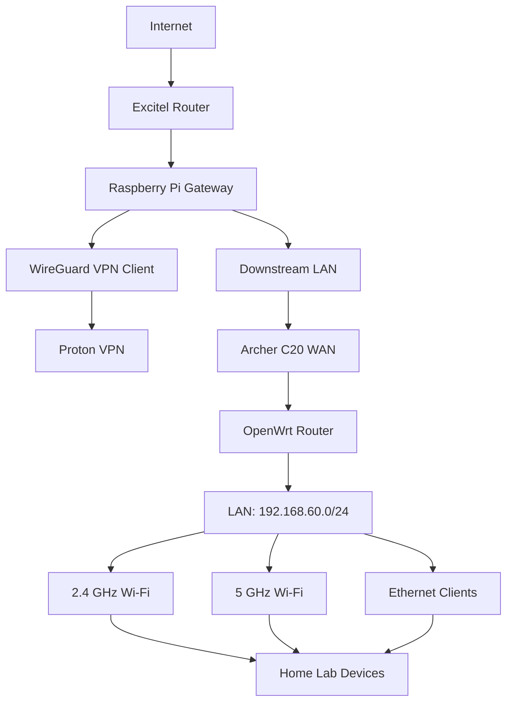

# TP-Link Archer C20 OpenWrt Configuration and VPN Gateway

## Overview

This project documents the configuration of a TP-Link Archer C20 v4 wireless router running OpenWrt, integrated with a Raspberry Pi-based WireGuard VPN gateway.

The objective is to create a dedicated home lab network where wireless clients connect to the Archer C20 and use the Raspberry Pi as their upstream gateway.

The Raspberry Pi establishes a WireGuard connection to Proton VPN and provides VPN routing, DNS restrictions, and firewall-based traffic protection.

The project combines router configuration, wireless networking, DHCP, gateway integration, VPN routing, and network security.

## Project Objectives

- Install and configure OpenWrt on TP-Link Archer C20 v4.
- Configure separate WAN and LAN networks.
- Provide DHCP services to wireless clients.
- Configure both 2.4 GHz and 5 GHz wireless networks.
- Connect the Archer C20 to a Raspberry Pi gateway.
- Route downstream network traffic through Proton VPN.
- Use WireGuard as the VPN protocol.
- Implement a firewall-based VPN kill switch.
- Prevent downstream traffic from bypassing the VPN tunnel.
- Restrict DNS traffic to the VPN-provided DNS service.
- Build a dedicated network for home lab devices.

## Hardware and Software

| Component | Configuration |
|---|---|
| Router | TP-Link Archer C20 v4 |
| SoC | MediaTek MT7628AN |
| Flash | 8 MB |
| RAM | 64 MB |
| Firmware | OpenWrt 19.07.10 |
| OpenWrt Revision | r11427 |
| WAN Interface | eth0.2 |
| LAN Interface | eth0.1 |
| LAN Bridge | br-lan |
| Wireless | 2.4 GHz and 5 GHz |
| VPN Gateway | Raspberry Pi |
| VPN Provider | Proton VPN |
| VPN Protocol | WireGuard |
| Firewall | nftables |

## Network Architecture

The Archer C20 operates as the downstream wireless router.

The Raspberry Pi acts as the upstream gateway and VPN router.

### Network Addressing

The lab uses three primary network segments.

| Network | Device / Purpose | Address |
|---|---|---|
| 192.168.1.0/24 | Excitel upstream network | Internet connectivity |
| 192.168.50.0/24 | Raspberry Pi–Archer connection | Gateway network |
| 192.168.60.0/24 | Archer C20 LAN | Wireless clients |

### Raspberry Pi Gateway

| Parameter | Value |
|---|---|
| Upstream interface | eth0 |
| Downstream interface | eth1 |
| Downstream IP | 192.168.50.1/24 |
| VPN connection | Proton VPN |
| VPN protocol | WireGuard |
| DNS | 10.2.0.1 |

### Archer C20

| Parameter | Value |
|---|---|
| WAN interface | eth0.2 |
| WAN IP | 192.168.50.13 |
| WAN gateway | 192.168.50.1 |
| LAN bridge | br-lan |
| LAN IP | 192.168.60.1 |
| LAN subnet | 192.168.60.0/24 |
| DHCP start | 192.168.60.100 |
| DHCP end | 192.168.60.199 |

## Architecture Diagram



**Traffic flow:**

Home lab client → Archer C20 → Raspberry Pi → WireGuard tunnel → Proton VPN.

The diagram represents the intended VPN traffic path. Full end-to-end traffic and leak protection must be verified from downstream clients before treating the configuration as production-ready.

## Part 1 – TP-Link Archer C20 OpenWrt Configuration

### 1. Router Hardware

The router used in this project is:

```text
Model: TP-Link Archer C20
Hardware Version: V4
SoC: MediaTek MT7628AN
Flash: 8 MB
RAM: 64 MB
```

### 2. OpenWrt Firmware

The router was configured using:

```text
OpenWrt Version: 19.07.10
Revision: r11427
```

The OpenWrt firmware provides control over wireless interfaces, networking, routing, DHCP, and firewall configuration.

**Firmware warning:** OpenWrt 19.07 is an end-of-life release and no longer receives security updates. It is documented here as the historical firmware used in this project, not as a recommended current installation.

### 3. WAN Configuration

The Archer C20 WAN interface connects to the Raspberry Pi gateway.

Current configuration:

```text
Interface: eth0.2
IP Address: 192.168.50.13
Subnet: 255.255.255.0
Gateway: 192.168.50.1
```

The Raspberry Pi is the upstream gateway for the Archer C20.

### 4. LAN Configuration

The Archer C20 provides a dedicated LAN network.

```text
Router LAN IP: 192.168.60.1
Subnet Mask: 255.255.255.0
DHCP Start: 100
DHCP Limit: 100
```

Expected DHCP client range:

```text
192.168.60.100 - 192.168.60.199
```

### 5. Wireless Configuration

Both wireless bands are used to provide connectivity to home lab clients.

| Wireless Band | Purpose |
|---|---|
| 2.4 GHz | General wireless connectivity |
| 5 GHz | Higher-bandwidth wireless connectivity |

The router was configured with separate wireless networks for the two bands.

Wireless credentials should be kept private and must not be committed to GitHub.

## Part 2 – Raspberry Pi VPN Gateway Integration

The Raspberry Pi is responsible for establishing the VPN tunnel.

The Archer C20 itself does not terminate the WireGuard connection in this architecture.

### 1. VPN Provider

The VPN provider selected for the project is Proton VPN.

WireGuard was selected instead of OpenVPN for the gateway implementation.

### 2. WireGuard Configuration

The Raspberry Pi uses a NetworkManager connection profile:

```text
pigateway-84
```

The profile was configured using a WireGuard configuration file.

The important configuration characteristics include:

```text
VPN Protocol: WireGuard
Allowed IPs: 0.0.0.0/0, ::/0
DNS: 10.2.0.1
```

The WireGuard configuration includes VPN endpoint information, private keys, and routing parameters.

These credentials and configuration secrets must never be committed to the public repository.

### 3. VPN Routing

The Raspberry Pi uses policy-based routing to direct intended gateway traffic through the WireGuard connection.

The configuration includes:

- WireGuard VPN connection.
- VPN-specific routing table.
- Firewall-based forwarding restrictions.
- DNS restrictions.
- VPN connection management through NetworkManager.

The downstream network is intended to use the VPN connection as its internet egress.

## Part 3 – VPN Kill Switch and Firewall

A major objective of this project is to prevent internet traffic from escaping through the ordinary ISP connection when the VPN connection is unavailable.

The Raspberry Pi uses nftables for firewall enforcement.

### 1. Firewall Configuration

The firewall configuration is maintained in:

```text
/etc/vpn-gateway.nft
```

A systemd service manages the firewall:

```text
vpn-gateway-firewall.service
```

The firewall service was configured to start automatically.

### 2. Kill Switch Behaviour

The firewall configuration uses a default-deny forwarding policy.

The intended security behaviour is:

1. Downstream traffic is permitted through the VPN tunnel.
2. DNS queries are restricted to the VPN DNS service.
3. If the VPN tunnel becomes unavailable, forwarding through an ordinary upstream interface must not be allowed.
4. Traffic must not automatically fall back to an unprotected ISP connection.

This is intended to provide fail-closed VPN behaviour.

### 3. Firewall Verification

Check firewall service status:

```bash
sudo systemctl status vpn-gateway-firewall.service
```

List nftables rules:

```bash
sudo nft list ruleset
```

Restart the firewall service:

```bash
sudo systemctl restart vpn-gateway-firewall.service
```

Check WireGuard status:

```bash
sudo wg show
```

Check NetworkManager connections:

```bash
nmcli connection show --active
```

The actual firewall rules and VPN configuration files should be stored privately or published only as sanitized examples.

## Part 4 – Verification and Testing

The following tests are important for validating the complete setup.

### 1. Check Router Connectivity

From the Raspberry Pi:

```bash
ping -c 4 192.168.50.13
```

From a client connected to the Archer C20:

```bash
ping -c 4 192.168.60.1
```

### 2. Check DHCP Assignment

On a client connected to the Archer C20:

```bash
ip addr
```

Verify that the client receives an address within:

```text
192.168.60.100 - 192.168.60.199
```

### 3. Check VPN Connection

On the Raspberry Pi:

```bash
sudo wg show
```

Verify that the WireGuard interface has a successful handshake and that traffic counters increase during testing.

### 4. Check DNS Resolution

From a downstream client:

```bash
nslookup example.com
```

Confirm that DNS resolution works when the VPN is active.

### 5. Verify Public IP

From a downstream client:

```bash
curl -4 https://ifconfig.me
```

Compare the result with the expected VPN exit IP, rather than the ISP's public IP.

### 6. Test Kill Switch Behaviour

A controlled kill-switch test should be performed:

1. Confirm internet connectivity through the VPN.
2. Record the downstream client's public IP.
3. Disconnect the WireGuard connection on the Raspberry Pi.
4. Attempt internet access from a client connected to the Archer C20.
5. Verify that internet traffic is blocked rather than falling back to the ISP.
6. Restore the VPN connection.
7. Confirm that connectivity returns through the VPN.

Perform this test only when the firewall rules have been reviewed and recovery access to the Raspberry Pi is available.

### 7. Verify Both Wireless Bands

Connect test devices independently to the 2.4 GHz and 5 GHz networks.

Verify:

- DHCP address assignment.
- Gateway connectivity.
- DNS resolution.
- VPN-based internet egress.
- Kill-switch behaviour.

## Current Implementation Status

| Component | Status |
|---|---|
| Archer C20 v4 hardware | Configured |
| OpenWrt 19.07.10 | Installed |
| WAN network | Configured |
| LAN network | Configured |
| DHCP | Configured |
| 2.4 GHz wireless | Configured |
| 5 GHz wireless | Configured |
| Raspberry Pi gateway | Configured |
| Proton WireGuard profile | Configured |
| nftables firewall | Configured |
| VPN kill-switch service | Enabled |
| End-to-end client VPN verification | Requires final validation |
| Both-band leak testing | Requires final validation |

## Known Limitations

- The installed OpenWrt 19.07.10 release is no longer maintained.
- The Archer C20 has limited flash and RAM capacity.
- The Archer C20 has 100 Mbps Ethernet ports.
- End-to-end VPN connectivity and leak protection must be verified independently from downstream clients.
- VPN routing and DNS behaviour depend on the Raspberry Pi gateway.
- Additional validation is needed before considering the configuration production-ready.

## Future Improvements

- Evaluate a supported firmware upgrade path or replacement router.
- Complete end-to-end VPN leak testing.
- Verify DNS leak protection.
- Verify IPv4 and IPv6 behaviour.
- Test VPN recovery after reboot.
- Test firewall recovery after service restart.
- Document the complete network configuration.
- Integrate VPN status with the Home Lab Monitoring Dashboard.
- Document client connectivity and router DHCP leases.
- Measure actual VPN throughput.

## Security and Privacy

This repository will be public.

Never upload:

- WireGuard private keys.
- Proton VPN credentials.
- VPN configuration files containing private keys.
- Wi-Fi passwords.
- Router administrator passwords.
- SSH private keys.
- API tokens.
- ISP account information.
- Unredacted router backups.
- Sensitive firewall configuration files.

Use placeholder credentials and sanitized configuration examples.

Keep the actual production configuration files in private storage.

## Learning Outcomes

This project demonstrates practical experience with:

- OpenWrt router administration.
- Linux networking.
- WAN and LAN configuration.
- DHCP and DNS.
- Wireless network configuration.
- WireGuard VPN.
- Proton VPN integration.
- Linux routing and policy-based routing.
- nftables firewall administration.
- VPN kill-switch design.
- Fail-closed network architecture.
- Network security and connectivity troubleshooting.

## References

- OpenWrt: https://openwrt.org/
- Archer C20 v4 device page: https://openwrt.org/toh/tp-link/archer_c20_v4
- OpenWrt 19.07 release information: https://openwrt.org/releases/19.07/start
- Proton VPN: https://protonvpn.com/
- WireGuard: https://www.wireguard.com/

## Disclaimer

This is a personal home lab project intended for learning, experimentation, and research.

The documented configuration is based on a privately maintained home network. Hardware, firmware, and network settings may evolve over time.

The historical firmware configuration should not be considered a recommendation for a new internet-facing deployment.

## Author

Personal Home Lab – Networking, VPN and Infrastructure

**Technologies:** TP-Link Archer C20 v4, OpenWrt, Raspberry Pi, Proton VPN, WireGuard, nftables, NetworkManager, dnsmasq, Linux.
